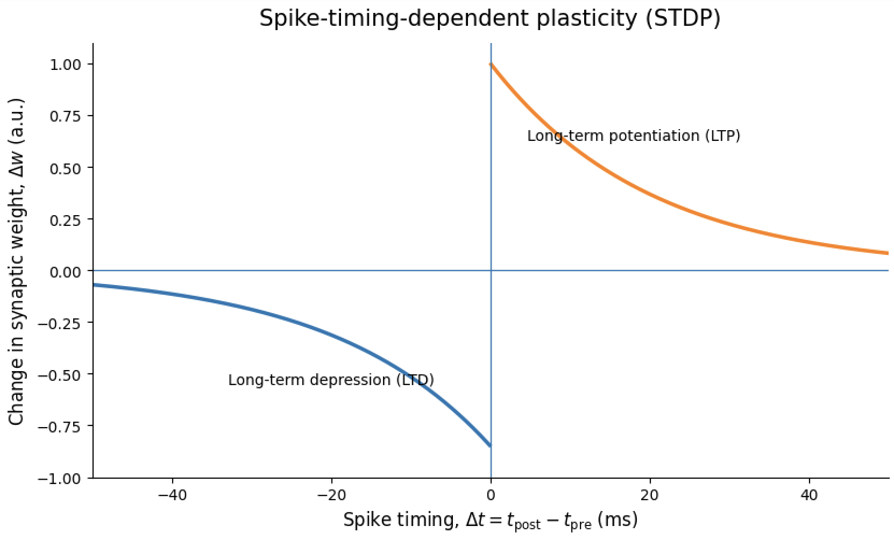

Please contact me at the below email address:
- <a href="mailto:eleanor.conole@ndcn.ox.ac.uk">eleanor.conole@ndcn.ox.ac.uk</a>  
  <small>Nuffield Department of Clinical Neurosciences, University of Oxford</small>  

My research in neuroepigenetics examines how long-term exposures shape individual differences in brain health across the lifespan. I am particularly interested in the relationship between epigenetics and heterogeneity in brain ageing, looking at how epigenetics relates to differences in cognitive functioning and neuroimaging. My research to date has been supported by funding from the Wellcome Trust (108890/Z/15/Z) and my current Junior Research Fellowship in Applied Artifical Intelligence (EPT-AI).

I currently teach a range of undergraduate and postgraduate courses at the University of Oxford. For students attending my tutorials, example essay feedback, problem-sheets, lecture slides and reading lists can be found under the [teaching tab](/teaching/) of this website.  

### Academic books

  

    

      
    

    

      

        <h4 class="card-title">
          OUP First Book Prize 2026
        </h4>

        

          My forthcoming book,
          <em>Neuroepigenetics: How We Live Shapes How We Age</em>,
          has been awarded the
          <strong>2026 Oxford University Press Early Career
          Researcher First Book Prize</strong>.
          The book explores how our environments and experiences
          across the life course are recorded in our epigenome,
          and what studying epigenetics might tell us about
          differences in brain and cognitive ageing.
        

        <a
          href="https://corp.oup.com/news/first-book-prize-2026-winners-announced/"
          class="btn btn-outline-primary"
          target="_blank"
          rel="noopener noreferrer">
          Read the prize announcement →
        </a>

      

    

  

### Interactive Teaching Resources

  

    

      
    

    

      

        <h4 class="card-title">Interactive Neurophysiology</h4>

        

          An interactive Python/Jupyter teaching resource introducing
          computational models of <strong>synaptic plasticity</strong>.
          Students explore short-term plasticity and STDP by manipulating
          parameters, fitting models, and analysing spike trains.
        

        <a href="https://github.com/EleanorSC/Neurophysiology-Teaching"
           class="btn btn-outline-primary"
           target="_blank">
          Explore the notebook →
        </a>

      

    

  

