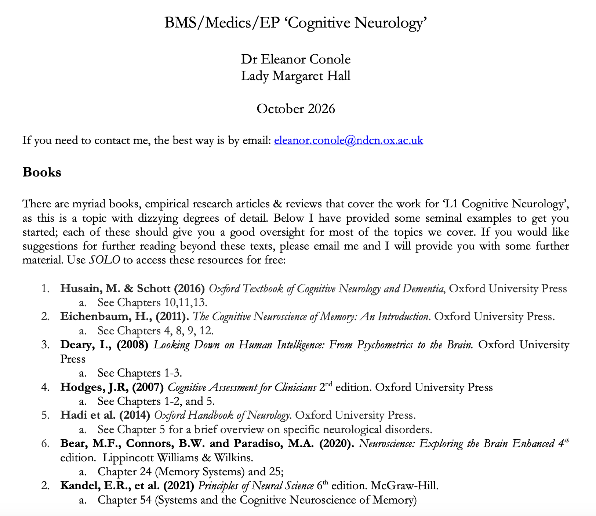

  

## L1 Cognitive Neurology -- Course Overview
This advanced CBN option covers the evidence for why neurological conditions such as stroke, Alzheimer’s disease, frontotemporal dementia and Parkinson’s disease present with distinct cognitive phenotypes we observe in clinic. Tutorials will consider how cognitive assessment together with neuroimaging and other investigations are used to make a diagnosis,  guide treatments, and understand the underlying neurobiology of these dusorders. The course will cover how studies of patients inform our understanding of normal cognitive function. We’ll cover a wide range of cognitive and behavioural dysfunction, neuropsychological tests used to assess patients and therapeutic interventions.

Students should first look to CANVAS to access previous lecture handouts, recorded lectures and reading lists for the Part B themes are available on CANVAS for Experimental Psychology Part B Advanced Options. Relevant Part A course handouts, recorded lectures and reading lists will also be available on CANVAS. New content from this year will be added onto CANVAS as it is delivered during the two teaching terms. 

## Topics Covered

- Organisation and function of the nervous system in relation to distinct aspects of cognitive functioning
- Canonical principles of cognitive neuroscience
- Neural basis of learning and memory
- Neurobiology of Language
- Neuropsychology and lesion studies
- Neuroimaging and experimental approaches to brain function

## Recommended Textbooks

- Gazzaniga, Ivry & Mangun — *Cognitive Neuroscience: The Biology of the Mind*
- Ward — *The Student's Guide to Cognitive Neuroscience*
- Purves et al. — *Neuroscience*
- Bear, Connors & Paradiso — *Neuroscience: Exploring the Brain*

## Teaching Format

Tutorials are delivered in a small-group format and focus on:

- Discussion of tutorial essays
- Critical evaluation of key experiments and theories
- Interpretation of neuropsychological and neuroimaging evidence
- Knowledge testing
- Examination-style questions and essay planning
